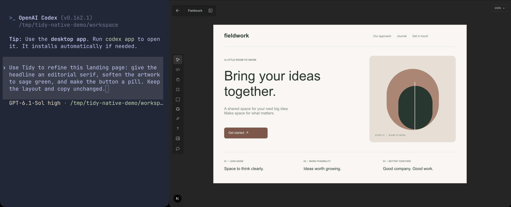

# Tidy

[](docs/demo/codex-canvas-teammate.mp4)

Tidy is a product canvas for designers, engineers and agents. It includes an
editable design workspace, collaboration, a webpage-capture extension and an MCP
server for working with designs through agents.

Tidy is open source under the [Apache License 2.0](LICENSE). Bundled third-party
assets retain their own licenses; see [third-party notices](THIRD_PARTY_NOTICES.md).

## Local development

Requirements: Bun 1.3.14, Git, Docker Compose and PostgreSQL 17 command-line tools
for the disposable database tests. Use your own development mail and optional
provider applications; the source contains no hosted-service credentials.

```sh
bun install --frozen-lockfile
docker compose up -d --wait
cp apps/web/.env.example apps/web/.env.local
```

Generate `BETTER_AUTH_SECRET` and a separate base64-encoded 32-byte
`VAULT_ENCRYPTION_KEY` in the app's local environment file. The example database
URL points to loopback PostgreSQL on port 55432; its password is a development
fixture, never a production credential. Do not inherit a production database URL
when running local commands. Fresh Docker databases apply ordered migrations
automatically; existing databases need the missing files from `migrations/`.

Password accounts must verify email before sign-in. Configure your own Cloudflare
Email Sending token, account and sender before creating accounts; disable email
previews that retain verification/reset links. Optional social sign-in,
connectors, analytics, billing and native agents stay unconfigured until you add
their own environment values in [the environment example](apps/web/.env.example).

```sh
bun dev
# In another terminal, for local realtime presence:
bun dev:realtime
```

Open `http://localhost:3000`. `bun dev:site` starts the optional landing page on
port 3001. `bun dev:extension` starts the WXT extension; its default server is
localhost. To load it in your own Chrome profile, run `bun run build:extension`,
enable Developer mode at `chrome://extensions`, and load unpacked
`apps/extension/.output/chrome-mv3`. Set `WXT_BELLA_URL` to your own HTTPS app
origin when building for distribution.

Stop the local database with `docker compose down`; adding `-v` removes its data.
Local Node development bypasses Worker-specific shared attempt limits. See
[self-hosting](#self-hosting) before exposing any deployment publicly.

## Importing Figma designs

On the Files screen or in a folder, choose **New file → Import from Figma…**
or drop a Figma Design `.fig` local copy. The dialog lets you choose the file
and select pages before creating a Tidy file in the current folder. Imported
files open immediately in the editor. To bring selected elements into an open
file, copy them in Figma and paste with the keyboard or Tidy's paste action.
No Figma plugin or account token is required.

The importer translates source records into editable native layers. It preserves
pages, hierarchy, paint order, supported vector geometry, images, text marks,
Auto Layout (including space-evenly), and resolvable component instances with overrides. Component masters
needed by a pasted instance live on an **Imported components** page. Color
variables become named snapshots; aliases and modes do not remain live bindings.

Alpha/luminance masks with supported vector sources or simple PNG image surfaces are
preserved as editable groups. Image masks use the original asset directly through
CSS masking, avoiding a second raster copy or per-frame image processing. Text
range bold, italic, underline and strikethrough marks remain editable.

This is a compatibility importer, not a guaranteed 1:1 round trip. Complex masks,
per-range font families/sizes/colors, complex component overrides/scales, variant axes, image crop transforms,
unsupported paints and effects can differ. Import notes identify approximations;
repeated notes are grouped. Fonts must be available to Tidy. FigJam and Slides are
not supported, and clipboard images without embedded bytes require a `.fig` copy.
The binary format is unofficial: decoder dependencies are pinned and regression
fixtures should be refreshed when Figma changes its exports.

Parsing runs in a disposable browser worker with a 20-second timeout. Limits are
32 MB input, 64 MB expanded data, 10,000 native layers, 100 images of up to 2 MB
and a 16 MB publication request. Documents retain the normal 5,000-unit layer
dimension ceiling. Oversized selections fail explicitly; choose fewer pages.
Published documents are bounded at 10 MB and pass the existing authorization,
asset quota and staged commit services. File publication uses one bounded staging
write rather than repeatedly rewriting a growing JSONB row. Off-screen free
frames use cached rendered overflow bounds for canvas culling; fonts and edits
invalidate those bounds conservatively.

For a database-free local prototype, run the web development server and open
`/dev/figma-import`. Use the Files creation menu to import a `.fig`, then open
the editor to paste native Figma elements.
The current draft, edits and image bytes are retained automatically in IndexedDB
and restored on reload. This is one local draft per browser origin; importing a
new file replaces it. The prototype route is unavailable in production builds.

Use `bun run test:figma:browser` against a local development server on port 3057
(or set `FIGMA_TEST_BASE_URL`). It checks real keyboard clipboard replay, native
hierarchy, source pixels, component dependency placement, undo/redo and recovery.
`bun run test:figma:publication:browser` uses an existing standalone build and owns
a disposable loopback PostgreSQL cluster. It checks authenticated import,
navigation, reload and access denial. PostgreSQL binaries must be on PATH, and
Node 22.18+ is required for the TypeScript publication runner. Run
`bun run test:files:db` for publication and folder permission regressions.
Optionally set `FIGMA_TEST_FILE` to a private multi-page design-system fixture
with over 5,000 layers to exercise the large-file checks in these suites. Keep it
outside the repository; browser screenshots and logs default to `/tmp`.

## Workspaces

| Workspace                  | Purpose                                     |
| -------------------------- | ------------------------------------------- |
| `apps/web`                 | Next.js application and Cloudflare Worker   |
| `apps/site`                | Optional static landing page                |
| `apps/extension`           | WXT webpage capture extension               |
| `apps/gpt-plugin`          | Agent plugin, skill and preview UI          |
| `packages/design`          | Browser-safe document and capture schemas   |
| `packages/design-renderer` | Shared editor, preview and export rendering |
| `packages/ui`              | Shared UI controls                          |

Workspace commands run from the root: `bun typecheck`, `bun lint`, `bun test` and
`bun run build`. Use `bun run build:worker` for the Cloudflare Webpack/OpenNext build.
Source archives and new repositories with no commits are supported. You can set
`NEXT_PUBLIC_APP_VERSION` for a release label independent of Git.

Database fixtures own disposable PostgreSQL clusters and simulate provider HTTP.
Run the relevant suites explicitly; default unit tests skip database suites.
The account suite is `bun run test:account-controls`; `package.json` also lists
auth, MCP, agents, plans, files, versions, images, clipboard, runtime, storage, multiplayer
and connector suites. See [contributing](CONTRIBUTING.md) for required checks.

Run `bun run bench:mcp` for authenticated MCP HTTP latency, throughput, query-count
and payload benchmarks against a disposable local database. These local measurements
do not represent hosted Worker performance.

## Self-hosting

The hosted app uses Cloudflare Workers, Hyperdrive, private R2 buckets, Images
and Durable Objects. The tracked `apps/web/wrangler.jsonc` is a build template.
Copy it to the ignored `apps/web/wrangler.deploy.jsonc` and configure your own
Worker name, matching `WORKER_SELF_REFERENCE`, domain, Hyperdrive connection and
storage bindings. Retain the Durable Object bindings and migration tags.

Use separate runtime and migration database logins. Apply ordered
[database migrations](migrations/README.md) and the restricted runtime grants
before starting the app. Configure `BETTER_AUTH_URL` to your HTTPS origin and
supply runtime variables and secrets through Cloudflare, using
`apps/web/.env.example` as the configuration reference. Keep secrets out of
Wrangler files and `NEXT_PUBLIC_*` variables. Preserve both auth and encryption
secrets when restoring an existing database.

From the repository root, build and deploy using your private configuration:

```sh
bun run build:worker
TIDY_DEPLOY_CONFIG=./wrangler.deploy.jsonc bun run deploy:worker
```

The configuration path is relative to `apps/web`. Preview and production need
separate secrets, databases and buckets. Test authentication and workspace
isolation with two users before accepting real data. Public Node deployments
require an equivalent shared limiter, private storage and realtime transport;
the Node commands support local development.

See the [agent plugin](apps/gpt-plugin/README.md) and
[native runner](apps/web/agent-runner/README.md) for agent setup.
CI uses synthetic fixtures and a read-only token. Report vulnerabilities privately
using the process in [SECURITY.md](SECURITY.md).
