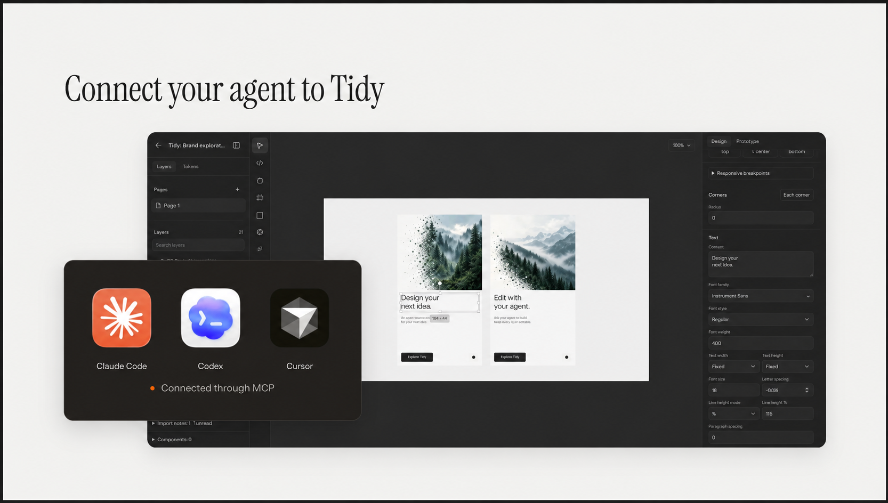
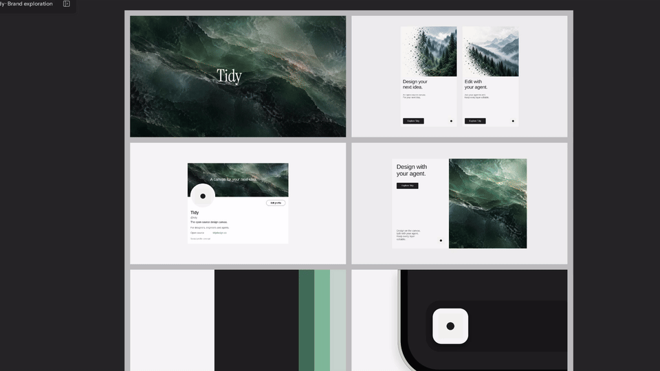

<p align="center">
  
</p>

<p align="center">
  An open-source canvas for designers, engineers and agents.
</p>

<p align="center">
  <a href="https://app.tidydesign.co">Try Tidy</a> ·
  <a href="https://tidydesign.co">Website</a> ·
  <a href="https://tidydesign.co/changelog">Changelog</a> ·
  <a href="CONTRIBUTING.md">Contribute</a>
</p>



<p align="center">Design together. Keep every layer editable.</p>

## Made for working together

- **Design on the canvas.** Create interfaces with editable layers.
- **Bring your agent.** Read, create and edit designs through MCP.
- **Work together.** Collaborate with teammates in the same workspace.
- **Capture webpages.** Bring webpages into Tidy with the browser extension.
- **Keep control.** Open source. Self-host on your own infrastructure.

## Watch Tidy in action

[](docs/demo/tidy-launch.mp4)

Watch the 19-second walkthrough. Click the preview for the full video with sound.

## Local development

You'll need Bun 1.3.14, Git and Docker Compose. Database tests also require
PostgreSQL 17 command-line tools.

```sh
git clone https://github.com/tidydesigns/tidy.git
cd tidy

bun install --frozen-lockfile
docker compose up -d --wait
cp apps/web/.env.example apps/web/.env.local
```

In `apps/web/.env.local`, generate and set `BETTER_AUTH_SECRET` and a separate
`VAULT_ENCRYPTION_KEY`. The encryption key must be a base64-encoded, 32-byte value.

Password accounts require email verification. Before creating an account,
configure your own Cloudflare Email Sending token, account and sender. Disable
email previews that retain verification or password-reset links.

The [environment example](apps/web/.env.example) lists the available settings.
Social sign-in, connectors, analytics, billing and native agents are optional.

Start the app:

```sh
bun dev
```

In another terminal, start realtime collaboration:

```sh
bun dev:realtime
```

Open [localhost:3000](http://localhost:3000).

The local database runs on port `55432`. Fresh databases apply migrations
automatically. For an existing database, apply any missing files from
[`migrations/`](migrations/README.md). Use a development database and your own
provider accounts. Do not use a production database URL for local commands.

Stop the database with `docker compose down`. Adding `-v` also deletes its data.
See [self-hosting](#self-hosting) before making a deployment public.

## Browser extension

The extension captures webpages for use in Tidy.

```sh
bun run build:extension
```

Open `chrome://extensions`, enable **Developer mode**, then choose
**Load unpacked** and select `apps/extension/.output/chrome-mv3`.

The extension connects to localhost by default. To build it for your own
deployment, set `WXT_BELLA_URL` to your app's HTTPS address.

Use `bun dev:extension` when developing the extension.

## Connect an agent

Tidy's MCP server lets agents work with the same files and designs you edit in
the canvas.

See the [agent plugin guide](apps/gpt-plugin/README.md) for setup, or the
[native runner guide](apps/web/agent-runner/README.md) for running agents
alongside Tidy.

## Self-hosting

Tidy's hosted architecture uses Cloudflare Workers, Hyperdrive for PostgreSQL
connections, private R2 storage, Images and Durable Objects for realtime
collaboration.

Copy `apps/web/wrangler.jsonc` to the ignored `apps/web/wrangler.deploy.jsonc`.
Configure your own Worker name, domain, database connection and storage bindings.
Set `WORKER_SELF_REFERENCE` to match the Worker name, and retain the Durable
Object bindings and migration tags.

Follow the [database setup guide](migrations/README.md). Apply the ordered
migrations and restricted runtime grants before starting the app. Use separate
database accounts for migrations and the running app.

Set `BETTER_AUTH_URL` to your app's HTTPS address. Use
[`apps/web/.env.example`](apps/web/.env.example) as the configuration reference,
and supply runtime settings and secrets through Cloudflare. Keep secrets out of
Wrangler files and `NEXT_PUBLIC_*` variables.

From the repository root:

```sh
bun run build:worker
TIDY_DEPLOY_CONFIG=./wrangler.deploy.jsonc bun run deploy:worker
```

The configuration path is relative to `apps/web`.

Use separate databases, storage and secrets for preview and production. Preserve
the authentication and encryption secrets when restoring an existing database.

Before accepting user data, test sign-in and workspace access with two users.
Node.js supports local development and bypasses some Worker-specific shared
rate limits. Public Node deployments need equivalent shared rate limits,
private storage and realtime transport.

## Contributing

Bug reports, documentation improvements and code contributions are welcome.
[Open an issue](https://github.com/tidydesigns/tidy/issues) to report a problem,
or read the [contribution guide](CONTRIBUTING.md) before opening a pull request.

Run workspace commands from the repository root:

```sh
bun typecheck
bun lint
bun test
bun run build
```

The contribution guide lists additional required checks. Database tests use
disposable PostgreSQL clusters and run separately; `bun test` skips those suites.
See [`package.json`](package.json) for available test commands.

### Repository layout

| Directory                  | Contents                                 |
| -------------------------- | ---------------------------------------- |
| `apps/web`                 | Canvas app, server and Cloudflare Worker |
| `apps/site`                | Website and changelog                    |
| `apps/extension`           | Webpage capture extension                |
| `apps/gpt-plugin`          | Agent plugin and design preview          |
| `packages/design`          | Shared design and capture formats        |
| `packages/design-renderer` | Editor, preview and export rendering     |
| `packages/ui`              | Shared interface controls                |

Use `bun dev:site` to run the website on port `3001`.

### MCP benchmarks

Run `bun run bench:mcp` to measure MCP request speed, throughput, database query
counts and response sizes against a disposable local database. These results
do not represent hosted Worker performance.

## Security

Please report vulnerabilities privately using the process in
[SECURITY.md](SECURITY.md). CI uses synthetic test data and a read-only token;
it does not deploy the app.

## License

Tidy is available under the [Apache License 2.0](LICENSE).

Bundled third-party assets retain their own licenses. See
[third-party notices](THIRD_PARTY_NOTICES.md).
