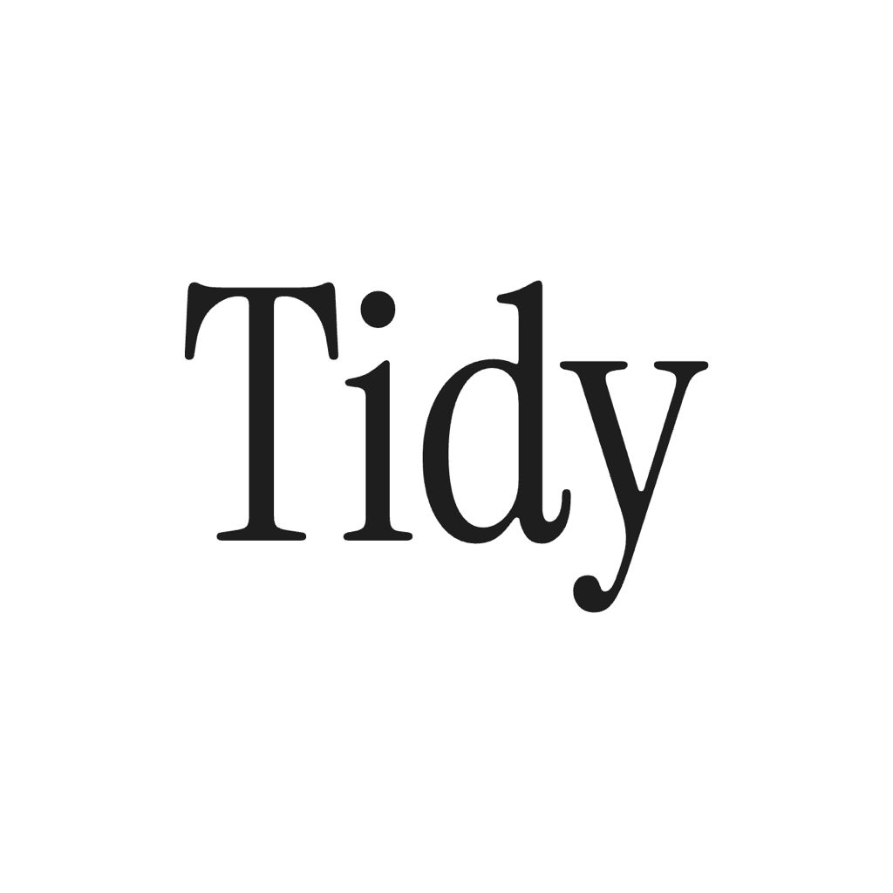
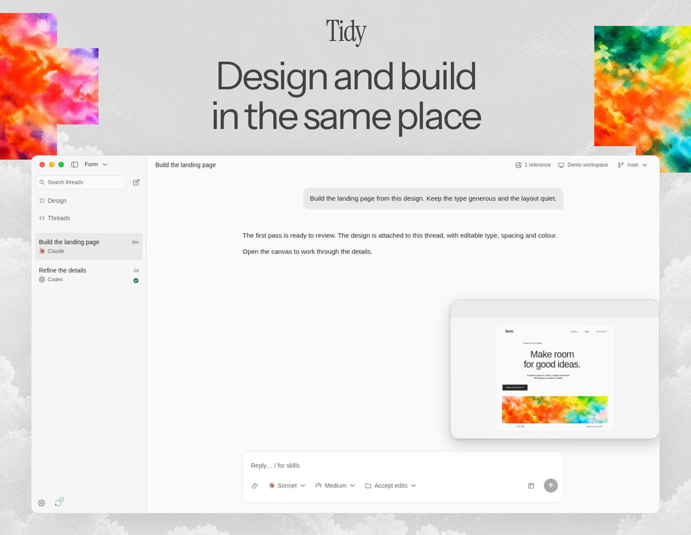
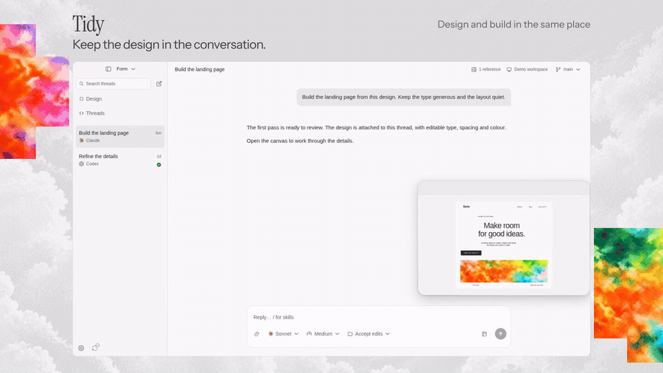

<p align="center">
  
</p>

<p align="center">
  Design and build in the same place
</p>

<p align="center">
  <a href="https://github.com/tidydesigns/tidy/releases">Download for macOS</a> ·
  <a href="https://tidydesign.co">Website</a> ·
  <a href="https://tidydesign.co/changelog">Changelog</a> ·
  <a href="CONTRIBUTING.md">Contribute</a>
</p>



Tidy is an open-source design tool and agentic development environment, or ADE.
The desktop app combines an editable canvas with coding agents that work in your
local project.

## What you can do

### Agentic development

Run coding agents in your local project to build features or change existing code.
Choose the agent, model and permissions for each thread. Follow its tool activity,
respond to approval requests and queue follow-ups while it works.

### Agentic design

Ask your agent to create an interface on the canvas, review the result and work
through changes in the same thread. Make changes on the canvas yourself or ask
the agent to revise the design. You both work with the same editable design file.

Attach a design to a coding thread so your agent can use it to build the interface.
Keep refining the design as you work on the code.

Local projects need no cloud account. Connect selected designs to a workspace to
share them. Your repository and local coding threads stay on your machine.

## See the desktop app

[](docs/readme/desktop-loop.mp4)

## Get started

[Download the macOS beta](https://github.com/tidydesigns/tidy/releases), open a
project directory, and start with a design or a coding thread. Coding threads
require a supported agent CLI installed and signed in on your machine.
See the [desktop guide](apps/desktop/README.md) for supported agents and setup.

To run the desktop app from source, install Bun 1.3.14 and Node.js 22.12+, then:

```sh
git clone https://github.com/tidydesigns/tidy.git
cd tidy
bun install --frozen-lockfile
bun dev:desktop
```

The desktop app runs without the web app, a database or environment configuration.
Coding threads use the agent CLIs and sign-ins already installed on your machine.

<a id="self-hosting"></a>

## Local development

- [Desktop development and packaging](apps/desktop/README.md)
- [Web app development and self-hosting](docs/development.md)
- [Agent connection guide](apps/gpt-plugin/README.md)
- [Database migrations](migrations/README.md)

Use the [browser app](https://app.tidydesign.co) to edit designs and collaborate
in a shared workspace. The [browser extension](apps/extension) captures webpages
as editable designs. The web development guide covers local setup and self-hosting.

## Contributing

[Report a bug](https://github.com/tidydesigns/tidy/issues) or read the
[contribution guide](CONTRIBUTING.md) before opening a pull request.

Run workspace commands from the repository root:

```sh
bun typecheck
bun lint
bun test
bun run build
```

The contribution guide lists additional checks. Database tests use disposable
PostgreSQL clusters and run separately; `bun test` skips those suites.
See [package.json](package.json) for available commands.

| Directory                  | Contents                                             |
| -------------------------- | ---------------------------------------------------- |
| `apps/desktop`             | Desktop workspace, local projects and coding threads |
| `packages/editor`          | Shared canvas, editing tools and inspectors          |
| `packages/design`          | Shared design and capture formats                    |
| `packages/design-renderer` | Preview and export rendering                         |
| `packages/ui`              | Shared interface controls and typography             |
| `apps/web`                 | Browser canvas, collaboration, server and API        |
| `apps/site`                | Website and changelog                                |
| `apps/extension`           | Webpage capture extension                            |
| `apps/gpt-plugin`          | Agent plugin and design preview                      |

## Security

Please report vulnerabilities privately using [SECURITY.md](SECURITY.md).

## License

Tidy is available under the [Apache License 2.0](LICENSE).
Bundled assets retain their own licenses; see [third-party notices](THIRD_PARTY_NOTICES.md).
