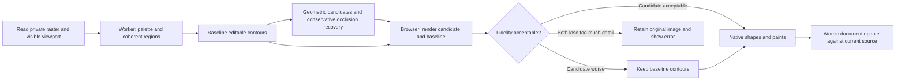

# Raster vectorisation: quality and architecture decisions

Research and implementation follow-up, 13 October 2026. Branch:
`feat/vectorisation-quality-pipeline`, based on latest `origin/main` (`dddb3f4`),
carrying forward the earlier tracing and meaningful-shape commits.

## Product goal and terminology

The target is a faithful, editable asset with coherent shapes, useful bounds and
manageable anchors. Similar appearance, low path count and semantic understanding
are separate properties. A vectorised flower can look correct while containing
many unhelpful fragments; a compact reconstruction can also erase a petal.

Our current implementation recognises geometry. It does not recognise subject
names, reconstruct components or restore editable text. Research does not justify
claiming that every competing vectorisation button does those things either.

## Competitor and engine research

| Product or approach            | Documented behaviour                                                                                                                                                                                                 | Decision for Tidy                                                                                                                                                                                                                                                                                           |
| ------------------------------ | -------------------------------------------------------------------------------------------------------------------------------------------------------------------------------------------------------------------- | ----------------------------------------------------------------------------------------------------------------------------------------------------------------------------------------------------------------------------------------------------------------------------------------------------------- |
| Figma Vectorize                | AI vector layers; colour-count, grayscale and threshold controls; caveats for complex and low-resolution inputs. Its help article does not disclose the model or promise semantic grouping.                          | Keep editable paths and simple controls; compare actual outputs before making parity claims. [Figma help](https://help.figma.com/hc/en-us/articles/38031452710807-Convert-static-images-to-vector-layers).                                                                                                  |
| Paper                          | Vectorisation and editing of vectorised SVG paths. Its build log separately identifies Quiver for SVG generation. That does not establish its raster vectorisation provider.                                         | Preserve the distinction between generation, tracing and import. [Paper build log](https://paper.design/build-log), [SVG editing](https://paper.design/docs/svg).                                                                                                                                           |
| Illustrator Image Trace        | Separate controls for path fit, corners and noise; fills versus strokes; abutting versus overlapping shapes; shape detection, preview, path/anchor counts and gradient tracing.                                      | Separate geometry from paint fitting and verify each result. Avoid exposing its full expert control panel by default. [Adobe options](https://helpx.adobe.com/in/illustrator/desktop/manage-objects/traces-mockups-symbols/image-trace-panel-options.html).                                                 |
| Vectorizer.AI                  | Combines learned and classical processing; whole-shape fitting, arbitrary rotation, symmetry and subpixel boundaries; automatic palette selection. These are vendor claims, not independently measured results here. | Add automatic colours and orientation-aware geometric candidates. Require our own rendering evidence. [Product description](https://vectorizer.ai/).                                                                                                                                                        |
| Vectorizer.AI output model     | Distinguishes stacked geometry, cutouts, grouping and seam handling; explicitly does not provide centre-line tracing.                                                                                                | Shape order and shared boundaries require their own models. Strokes must not be implied by filled outlines. [Output documentation](https://vectorizer.ai/api/outputOptions).                                                                                                                                |
| Inkscape / Potrace / Autotrace | Multiple tracing strategies, including centre-line tracing for line drawings. Potrace is predominantly bitmap-outline tracing; its distribution is GPL, with a separate commercial offering.                         | Do not treat outline tracing as stroke recovery, or silently add a differently licensed runtime. [Inkscape guide](https://inkscape-manuals.readthedocs.io/en/latest/tracing-an-image.html), [Potrace](https://potrace.sourceforge.net/).                                                                    |
| VTracer                        | Hierarchical clustering, path walking, simplification, corner-aware smoothing and curve fitting; stacked output. Its current repository also documents a substantial architecture rewrite.                           | Evaluate as a separate engine, with pinned version and browser integration tests, rather than replacing our pipeline from a speed benchmark alone. [Algorithm](https://www.visioncortex.org/vtracer-docs/), [source and design](https://github.com/visioncortex/vtracer/blob/master/docs/design/README.md). |
| Quiver image-to-SVG            | Dedicated model-based vectorisation API, distinct from generating a new design from a reference. Its guide recommends checking geometry, colour, transparency and editability.                                       | Suitable for evaluating semantic reconstruction, but requires a separate server-side provider decision and output validation. No provider was called in this work. [API](https://docs.quiver.ai/developers/models/image-to-svg), [inspection guide](https://docs.quiver.ai/app/prompt-guide).               |

The useful conclusion is not “add AI and the problem disappears”. Whole-shape
fitting, topology, paint estimation, draw order, simplification and image-space
verification remain important even in products with learned engines.

## Research papers and algorithm choices

- [Image Vectorization: a Review](https://arxiv.org/abs/2306.06441) describes several
  distinct families. No single method establishes suitability for all artwork.
- [Image Vectorization with Depth](https://arxiv.org/abs/2409.06648) explicitly
  models shape layers and depth ordering before reconstructing occluded shapes.
  Our previous area-sorting heuristic is not equivalent to that model.
- [Adobe gradient reconstruction research](https://research.adobe.com/publication/image-vectorization-via-gradient-reconstruction/)
  separates smooth paint estimation from geometric boundaries. A gradient should
  not automatically become dozens of bands.
- [DiffVG](https://people.csail.mit.edu/tzumao/diffvg/) demonstrates the value of
  comparing rendered vectors in image space. We use ordinary browser rasterisation
  as a validation gate; we are not implementing differentiable optimisation.
- [PolyVector line-drawing vectorisation](https://arxiv.org/abs/1801.01922) treats
  curve connectivity and junctions as a substantive problem. A quick skeleton
  followed by independent short segments is insufficient for editable strokes.
- [Schneider curve fitting implementation](https://github.com/soswow/fit-curve)
  is a candidate for future tangent-aware curve refitting. It was researched,
  not added as a dependency or copied into this implementation.

## Implemented architecture

The modules now have clearer responsibilities:

| Module                    | Responsibility                                                                                                                           |
| ------------------------- | ---------------------------------------------------------------------------------------------------------------------------------------- |
| `raster-trace-client.ts`  | Private byte read, decode, visible crop/fit/adjustments, source-density sizing, worker lifecycle, cancellation and verification handoff. |
| `raster-regions.ts`       | Coverage, deterministic palette, spatial edge assignment and bounded JPEG fragment cleanup.                                              |
| `raster-gradient.ts`      | Conservative single-region, two-stop linear paint estimation.                                                                            |
| `raster-trace.ts`         | Bounded contour tracing, geometric candidates, fallback assembly and schema validation.                                                  |
| `raster-shape-fit.ts`     | Rotated ellipse/rectangle/rounded-rectangle fitting and bounded concavity-preserving polygon simplification.                             |
| `raster-occlusion.ts`     | Existing conservative reconstruction; future region-graph replacement described below.                                                   |
| `raster-trace-quality.ts` | Actual canvas rendering, measured errors, candidate selection and rejection.                                                             |
| `raster-vectorisation.ts` | Native layer bounds, paint-coordinate conversion, current-document source fence and atomic commit.                                       |

An engine contract returns native contours and supported paints, not arbitrary
SVG markup. Browser processing stays separate from mutation. The transient
baseline is removed before committing, so it adds no duplicate document layers.
Existing persistence, multiplayer, native SVG export and point editing are reused.
No database migration, external API integration or new runtime dependency is added.

### Automatic palette and JPEG handling

Auto chooses up to 32 supported colours; explicit 2/8/16/32 choices remain available.
Repeated flat cores preserve intentional close shades. Rare colours require local
support instead of merely occupying a histogram bucket. JPEG interiors tolerate
local compression variation; mixed edge colours are evaluated against existing
paints. High-contrast small accents remain candidates even when they occupy very
little area.

JPEG-only component cleanup can reassign regions of at most 64 pixels to an
adjacent colour within a bounded RGBA distance. It never merges all same-colour
objects or fills transparent regions. This is a conservative noise heuristic,
not semantic classification. Very small low-contrast details remain difficult.
PNG receives no JPEG component cleanup; lossless WebP is not assumed to be JPEG.

### Rotated and general geometry

The fitter considers orientation as well as axis-aligned bounds. Rectangle
orientation comes from a minimum-box search; ellipse orientation also considers
boundary residual. New candidates allow up to 1.5 working pixels of boundary
error and still pass the final rendered-image test. Named shapes remain ordinary
native editable paths rather than a new document node type.

Polygon simplification preserves concavities and limits deviation to 0.9 working
pixels. It does not substitute convex hulls for arbitrary objects. The recursive
work is bounded and large/complex contours retain their curves. Hearts, lettering
and freeform illustrations can remain cubic paths; “unrecognised primitive” is not
an error and does not justify splitting a coherent object into more layers.

### Editable linear shading

Auto may fit a single visible colour region to a two-stop linear gradient. RGB
planes are fitted independently, their directions must agree, alpha must behave
like one fill plus coverage, and residuals are checked against interior pixels.
The model declines nonlinear shading, incompatible directions and multiple
flat-colour objects. It is intentionally narrower than Adobe's multi-region and
radial reconstruction.

The silhouette is traced independently and the paint uses existing native linear
fills. Gradient endpoints are remapped when the layer receives tight bounds.
The gradient survives SVG export and remains editable in the existing inspector.
Manual colour-count choices continue to produce quantised solid fills.

### Fidelity and reliability gates

Each proposed optimisation is compared with the unsimplified coherent-region
baseline by rendering both with `CanvasRenderingContext2D` and `Path2D`. The latter
is a browser-supported path representation, not an SVG DOM importer.
[Browser API reference](https://developer.mozilla.org/en-US/docs/Web/API/Path2D).

Measurements check premultiplied colours on both dark and light backgrounds,
alpha, materially changed area and worst local 16px tile error. A candidate may
increase mean error by at most 0.5 channel units, alpha error by 0.5, changed area
by 0.5 percentage points and worst tile error by eight units relative to baseline.
Otherwise the baseline is used. Global mean error over 20, changed area over 30%,
or worst tile error over 80 rejects the result altogether. These thresholds are
engineering policies with regression coverage, not universal perceptual guarantees.

Local tiles matter: deleting a small accent can barely change an image-wide
average. Transparent mistakes must not disappear into a white-background score.
No numeric “AI confidence” is invented or displayed.

The existing caps remain: 262,144 working pixels, 1,024px edge, 256 output paths,
12,000 anchors, editable per-path schema limits and 20-second worker timeout.
Candidate and fallback are each bounded to 1.5MB; both can be transferred while
only one is committed. Source reads remain capped at 2MB. Cancellation terminates
the worker and aborts reading; cancellation is checked again before verification
and commit. The yielding verification task is cancellable. Source changes, locks,
removal and component/style restrictions still reject stale completion.

## Feature layout and interaction decisions

| Before                                               | After                                                          | Why                                                                              |
| ---------------------------------------------------- | -------------------------------------------------------------- | -------------------------------------------------------------------------------- |
| Default fixed eight-colour palette                   | Auto, with explicit colour limits in the existing `SelectMenu` | Preserve additional meaningful colours without requiring the user to count them. |
| Generic “Vectorising” status                         | Reading image, Finding shapes, Checking result                 | Report real stages without fake percentage progress.                             |
| Any geometrically valid trace can replace the source | Verify; fall back or retain the original on excessive loss     | Compact output is not automatically a successful conversion.                     |

The action retains one home in the image editor, with the existing immediate
conversion and undo workflow. No save step, duplicate toolbar action or empty
quality panel is introduced. Secondary future controls belong behind a disclosure;
the image editor's existing scroll limit keeps controls reachable at smaller heights.

A comparison preview is useful, but should be integrated with a future re-trace
workflow that retains the source asset and its recipe. Adding a modal with an
“Apply” button now would create a second interaction model and leave source
retention, undo and source-version races unresolved. This pass uses automatic
validation and supplies a separate browser inspection report for engineering review.

## Engine evaluation and technical decision

We ran an expanded nine-fixture PNG/JPEG comparison against locally installed
`@visioncortex/vtracer` 1.0.0-alpha.4, using its poster preset and 32-colour limit.
The same decoded 624 × 380 inputs were rendered and measured. These are core-engine
runs, excluding browser verification, native import, WASM cold start and commit.
They are not a claim of parity with paid competitor services.

VTracer is substantially faster in many cases, but a preset produces very
different tradeoffs across gradients, compression, alpha and topology. Our
single-region gradient model and geometry/paint contract solve problems that an
engine swap alone does not. The alpha package's Node integration also does not
establish reliable worker bundling in Next/Turbopack/Webpack.

Decision: retain the current local engine for this release, add an independent
candidate verification stage, and keep the engine boundary replaceable. Before
adopting VTracer, test poster/photo presets, colour precision, speckle filtering,
transparency, transformed path conversion, cold start, worker asset delivery,
license notices and production builds. Do not add a server round trip merely to
run a CPU trace that can already stay local.

## Further implementation plan

1. **Region graph and shared boundaries.** Retain connected-component identity,
   adjacency, containment and shared edge ownership after segmentation. Replace
   global colour-area ordering with explicit occlusion constraints and an acyclic
   depth graph. Verify every replacement in image space; reject inconsistent
   constraints. Success means crossing/overlapping shapes remain independently
   editable without seams or incorrect paint order.
2. **General curve fitting.** Evaluate a pinned permissively licensed curve fitter
   or VTracer's stable core. Preserve corners and junctions, fit smooth runs with
   tangent continuity and align shared edges. Test symbols, curves, text outlines,
   scanned art and different source resolutions. Accept only reductions in anchors
   that preserve topology and measured fidelity.
3. **Multi-region paint fitting.** Analyse colour variation within region masks,
   fit solid/linear/radial paints separately, and validate locally. A gradient on
   one object must not absorb a differently coloured foreground object. Preserve
   native paints through editing, transforms and all supported exports.
4. **Stroke recovery.** Build a separate connected centre-line graph with widths,
   corners, junctions and cap/join semantics. Start with clean monochrome constant
   widths. Variable widths need a supported representation or an explicit outline
   fallback. Do not relabel narrow filled contours as recovered strokes.
5. **Semantic provider evaluation.** Benchmark a model-based image-to-SVG service
   on the same corpus before choosing it. Use authenticated server-side private
   bytes, scoped access, quotas, cancellation and native output sanitisation.
   Measure cost, latency, visual fidelity, hidden geometry, text accuracy and
   editability. Keep interpretation distinct from faithful conversion. Provider
   credentials, image sharing and charging policy are unresolved product decisions.
6. **Re-trace UX.** Retain source plus conversion recipe so designers can compare
   original/result and alter fidelity, paint count or structural interpretation.
   Integrate this in the existing inspector, apply changes immediately and keep
   one undoable document operation. Validate collaboration/source races before
   exposing live previews.

## Validation and limits

The committed browser harness covers rotated PNG/JPEG objects, concave shapes,
a native gradient, twenty colours, close shades, a small JPEG accent and thin
transparent cutouts. It checks native SVG export and undo/redo, plus rejection and
retry after excessive colour loss. Existing browser suites cover point editing,
independent movement/recolouring, crop/zoom/adjustments and cancellation.

The actual screenshot/video gallery and engine measurements are ignored local
artifacts under `.artifacts/general-browser/` and `.artifacts/vectorisation-research/`.
Fixtures are synthetic; no customer artwork or production database was used.

Remaining gaps are explicit: semantic objects/components/text are not recovered;
most photos still exceed native complexity limits; overlapping translucent paints
are approximated; JPEG line art can contain extra fragments; and multi-region or
radial gradients still become bands. Validation rejects severe loss but cannot
prove that a visually similar result has the original author's layer structure.

## Current browser evidence

Nine actual browser conversions pass through the image editor and render gate:
rotated PNG shapes → 3 paths; the JPEG variant → 4 including its white background;
concave PNG shapes → 3; JPEG → 4; clean linear shading → 1 editable gradient;
twenty-colour artwork → 20; close-colour PNG with a small accent → 3; JPEG → 4;
and the thin-cutout case → 1 path retaining three contours. A deliberately excessive
two-colour reduction is rejected, and retrying Auto succeeds without a partial
conversion. Native SVG export and undo/redo pass for all nine conversions.

Some clean synthetic sources produce extremely low error. Those results should
not be generalised to scans, photographs or compressed low-resolution logos.
JPEG line art and gradient-on-opaque-background cases in the engine matrix retain
many regions; they remain in the report instead of being omitted.

### Comparison with the preceding implementation

These are defaults, not equally constrained palette settings: the preceding
implementation uses eight colours; the new default uses Auto. The following
core-engine measurements use identical decoded inputs and the new light/dark
error metric. Browser commit verification is an additional step.

| Case                                | Previous default              | New default                     | Colour error before → after |
| ----------------------------------- | ----------------------------- | ------------------------------- | --------------------------- |
| Rotated PNG geometry                | 3 paths, 36 anchors           | 3 fitted paths, 16 anchors      | 0.259 → 0.385               |
| Clean two-stop PNG gradient         | 5 band paths, 57 anchors      | 1 gradient path, 4 anchors      | 3.027 → 0.050               |
| Twenty-colour PNG                   | 20 paths with reduced colours | 20 paths preserving all colours | 3.306 → 0.057               |
| Close-colour JPEG with small accent | 3 paths; accent missing       | 4 paths; accent retained        | 2.154 → 0.253               |

The rotated case deliberately accepts a small fidelity tradeoff for cleaner,
recognisable geometry; final browser verification still checks the candidate.
Some JPEG line/cutout cases have higher error than before and remain unresolved.
No universal improvement claim is made from these synthetic examples.

Canvas gradient handles are currently unavailable on native vector nodes in the
existing editor. Inspector stop and angle edits are supported and tested; this
pass does not enable a handle overlay whose live preview was built for CSS fills.

Final verification includes root type checking, lint/formatting, 822 passing unit
tests with 665 database-gated skips, nine general-shape browser cases, the existing
raster suite (PNG/JPEG/WebP, crop/zoom/adjustments, cancellation), native vector
editing/import/export tests, and a reachable action at 960 × 640. Build results
are recorded separately below.

The standard production build passes across all workspaces. Browser inspection
also confirmed native gradient-stop editing and the 960 × 640 scroll layout.
Environment symlinks are restored after local builds; no primary environment file
is modified and no deployment or production database operation is performed.
